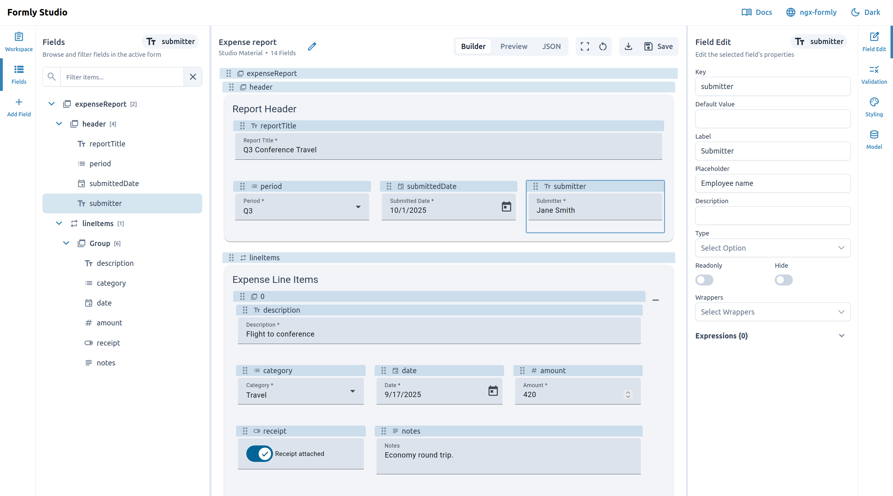

# Formly Editor

Formly Editor is a configurable editor framework for building ngx-formly forms in Angular. Its browser-local demo, Formly Studio, lets you build, preview, and export forms as JSON.

Live Studio App: https://formlystudio.com

See the [developer documentation](https://docs.formlystudio.com/developers/) to set up the editor from this repository, configure UI profiles, add custom components, and use exported forms in your application.
