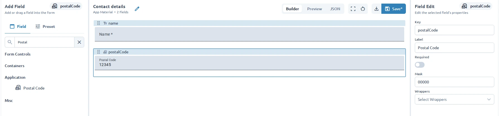

Start with the App Material profile from [Configure a UI profile](/developers/configure-a-ui-profile/).
This example adds the existing Studio postal-code component. Use the same steps for your own
registered Formly type; component implementation remains ordinary ngx-formly code.

## 1. Register the runtime type

Replace the profile's runtime factory with:

```ts title="app-material.config.ts"
import { withPostalCodeType } from '@formly-editor/material';
import { materialConfigOptions } from '../material/material.config';

export function appMaterialConfigOptions() {
  return [...materialConfigOptions(), withPostalCodeType()];
}
```

`withPostalCodeType()` registers `postal-code`, its Material `form-field` wrapper, and validation
messages. The Material configuration supplies that wrapper's implementation.

For your own component, supply a Formly `ConfigOption` with a named type registration:
`{ types: [{ name: 'your-type', component: YourFieldType }] }`. Named types allow saved JSON to
refer to components without containing Angular classes. See Formly's
[custom types](https://formly.dev/docs/guide/custom-formly-field) guide for component authoring.

## 2. Expose the type and its properties

Replace the catalog alias with a composed catalog:

```ts title="app-material.options.ts"
import { createInputProperty, FieldTypeOption } from '@formly-editor/core';
import {
  formFieldWrapperOptions,
  keyProp,
  labelProp,
  materialFieldCategoryOptions,
  requiredProp,
} from '../material/material.options';

const postalCodeTypeOption: FieldTypeOption = {
  name: 'postal-code',
  displayName: 'Postal Code',
  materialSymbol: 'local_post_office',
  keyGenerationPrefix: 'postal',
  defaultConfig: {
    props: { label: 'Postal Code', mask: '00000', inputMode: 'numeric' },
  },
  wrapperOptions: formFieldWrapperOptions,
  properties: [
    keyProp,
    labelProp,
    requiredProp,
    createInputProperty({ label: 'Mask', key: 'props.mask', dataType: 'text' }),
  ],
};

export const appMaterialFieldCategoryOptions = [
  ...materialFieldCategoryOptions,
  { displayName: 'Application', children: [postalCodeTypeOption] },
];
```

The metadata `name` must match the runtime type. `defaultConfig` supplies inserted-field defaults;
the property key `props.mask` identifies the value edited in the field configuration. The component
must actually consume that property. This compact example exposes only a subset of the component's
options; use the
[full Studio metadata](https://github.com/sesan07/formly-editor/blob/main/apps/studio/src/app/form-editor/studio-material/studio-material.options.ts)
for boolean, select, validation, and preset examples.

## 3. Exercise it in a template

Add this field to the Contact details template:

```ts
{
  key: 'postalCode',
  type: 'postal-code',
  props: { label: 'Postal Code', mask: '00000', inputMode: 'numeric' },
}
```

Create a new form from the template. Existing saved forms do not acquire later template changes.
Edit Mask, then check Preview, model values, validation, JSON, and export/reimport.



## Wrappers and containers

Wrappers need runtime registration and a matching `FieldWrapperOption` on the field type's
`wrapperOptions`. Supply a user-facing `label` and properties for values the wrapper consumes.
Wrapper metadata alone does not apply a wrapper: use runtime type defaults or the field's
`wrappers` array. Do not reuse a Material wrapper for a different UI library without checking its
dependencies. See Formly's [custom wrappers](https://formly.dev/docs/guide/custom-formly-wrapper).

For groups, use `isParent: true` with `fieldGroup`; repeaters also use `isFieldArray: true` with
`fieldArray`. Follow Studio's card and repeating-section examples rather than maintaining a second
editor state model.

Tabs and steppers need special authoring behavior in Studio. Their `builderConfigOptions` use
adapters from `@formly-editor/builder-material`; `configOptions` retain the real runtime components
for Preview. Simple fields such as postal code do not need a builder override.

## Runtime portability and checks

Register custom validators and messages in runtime configuration too. Link their named references
from fields, and expose the relevant editor properties. Use JSON-compatible options and string
expressions for portable examples. JSON is not a bundle of functions, hooks, services, or components;
your consuming application must supply the same runtime dependencies. See Formly's
[validation](https://formly.dev/docs/guide/validation) and
[expressions](https://formly.dev/docs/guide/expression-properties) guides.

| Symptom                                      | Check                                                                                     |
| -------------------------------------------- | ----------------------------------------------------------------------------------------- |
| Type renders but is missing from the palette | Add it to the active profile's field catalog.                                             |
| Unknown type or wrapper                      | Match names and check runtime registrations.                                              |
| A property edit has no effect                | Check the property path and the component's supported props.                              |
| Preview works but the exported form fails    | Register the same types, wrappers, validators, services, and styles in the consuming app. |

Adapt the existing
[Studio profile tests](https://github.com/sesan07/formly-editor/blob/main/apps/studio/src/app/form-editor/studio-material/studio-material.library.spec.ts)
and [integration tests](https://github.com/sesan07/formly-editor/blob/main/apps/studio/src/app/form-editor/studio-material/studio-material.integration.spec.ts).
Check catalog/runtime names, defaults, wrapper compatibility, template `libraryId`, property edits,
profile switching, and exported fields without editor `_info` metadata. Run `npm run test:studio`
and `npm run build:studio`; also run the affected library suite if you change a reusable component.

Finally, [render the exported form in your Angular application](/developers/use-an-exported-form/).
