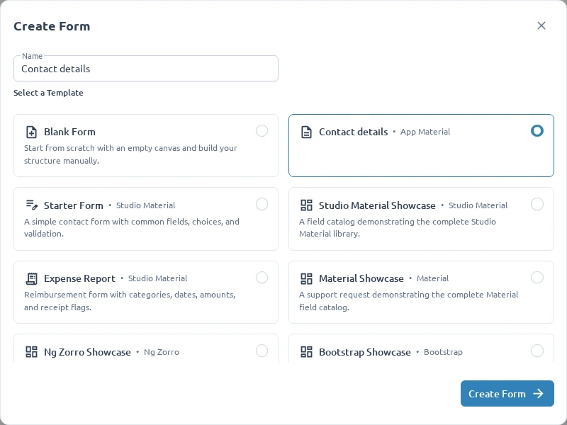

A UI profile describes the forms your editor can author. It combines Formly runtime registrations
with a field catalog and starter forms. Different profiles can use the same type name, such as
`input`, with different implementations.

After [setting up Studio](/developers/set-up-your-editor/), create
`apps/studio/src/app/form-editor/app-material/`. This example reuses the existing Material setup
under a new profile ID, leaving the shipped profiles unchanged.

## 1. Choose the runtime and field catalog

```ts title="app-material.config.ts"
import { materialConfigOptions } from '../material/material.config';

export function appMaterialConfigOptions() {
  return materialConfigOptions();
}
```

```ts title="app-material.options.ts"
import { materialFieldCategoryOptions } from '../material/material.options';

export const appMaterialFieldCategoryOptions = materialFieldCategoryOptions;
```

The runtime configuration registers components, wrappers, validators, and messages. The catalog
defines what appears in the palette, the defaults used when inserting fields, and which properties
authors can edit. Both must describe the same supported fields.

For another UI library, use its Formly adapter and matching metadata instead. Verify the adapter's
actual type and wrapper registrations and include its styles and dependencies. A control supported
by the UI library is not necessarily supported by its Formly adapter.

## 2. Add a starter form

```ts title="app-material.forms.ts"
import { DefaultForm } from '@formly-editor/core';

export const formTemplates: DefaultForm[] = [
  {
    name: 'Contact details',
    libraryId: 'form-app-material',
    fields: [
      {
        key: 'name',
        type: 'input',
        props: { label: 'Name', required: true },
      },
    ],
    model: { name: '' },
  },
];
```

Templates belong to their profile through `libraryId`. Keep this ID stable: saved forms use it to
select the profile. Renaming it requires migrating those forms; an unknown ID fails rather than
silently selecting Material.

## 3. Compose the profile

```ts title="app-material.library.ts"
import { createLibrary } from '@formly-editor/core';
import { appMaterialConfigOptions } from './app-material.config';
import { formTemplates } from './app-material.forms';
import { appMaterialFieldCategoryOptions } from './app-material.options';

export const appMaterialFormEditorConfig = createLibrary({
  id: 'form-app-material',
  label: 'App Material',
  configOptions: appMaterialConfigOptions(),
  fieldCategoryOptions: appMaterialFieldCategoryOptions,
  formTemplates,
  enableFormUploadSchema: true,
});
```

`createLibrary()` generates the import schema from the field metadata. You do not supply a separate
schema. Import validation checks configuration structure; it does not prove that components render
correctly or that application services are available.

## 4. Register it with Studio

In `form-editor.provider.ts`, import the profile:

```ts
import { appMaterialFormEditorConfig } from './app-material/app-material.library';
```

Add it to the existing `provideCoreConfig([...])` array alongside the shipped profiles. Keep
`provideFormlyCore()`, `provideCore()`, and `provideLocalFormStore()` in place. Templates are already
included in the profile; they do not need a separate provider.

## Verify the profile



- Create a form with App Material and open its Contact details template.
- Add, configure, and preview a standard field; confirm the expected model and validation.
- Reload the saved form and confirm the same profile opens.
- Switch between App Material and another profile; check that each uses its own fields and wrappers.
- Export the field array and import it into another App Material form.

Use the existing
[Material profile tests](https://github.com/sesan07/formly-editor/blob/main/apps/studio/src/app/form-editor/material/material.library.spec.ts)
as a starting point for a neighboring `app-material.library.spec.ts`: check the ID, catalog, runtime
registrations, and template ownership. Run `npm run test:studio` and `npm run build:studio` after
adding application code.

Next, [add custom components](/developers/add-custom-components/) to this profile.
