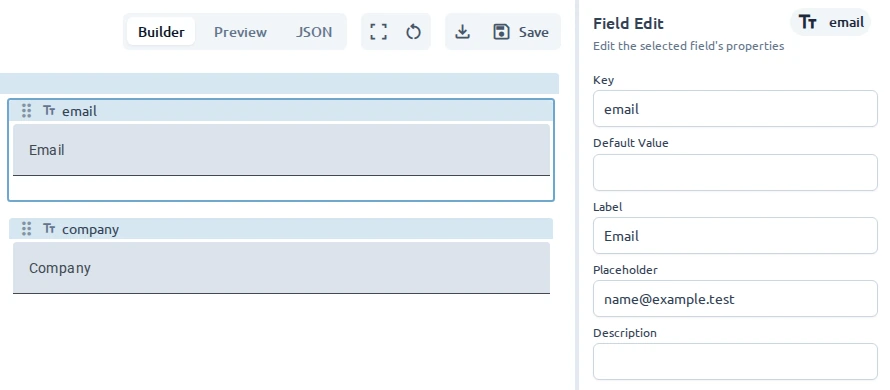

Open a form in **Builder** mode. The form's UI library determines which fields and settings are
available and cannot be changed after the form is created.

## Add a field

1. Open **Add Field** in the sidebar.
2. Select **Field**.
3. Find a field under **Basic Fields**, or filter the list.
4. Drag the field onto the canvas.

The field appears on the canvas and in the **Fields** panel. Select it in either place to open its
settings in **Field Edit**.

## Set its identity and text

Start with the properties that identify the value and explain it to users:

- **Key** identifies the value in the form model. Use a unique, descriptive key such as `email`.
- **Label** names the field.
- **Placeholder** provides a hint inside an empty control.
- **Description** adds supporting text.
- **Default Value** sets the initial value.
- **Hide** and **Readonly**, when available, control visibility and editing.

The form name, field label, and field key serve different purposes. The form name identifies the
document in **Workspace**, the label is visible to users, and the key identifies the stored value.

## Configure the field type

**Field Edit** shows settings supported by the selected field and UI library. Common examples
include:

- Input mode for email, password, telephone, URL, or numeric input
- Minimum and maximum values for numbers
- Rows and automatic sizing for text areas
- Calendar behavior for dates
- Label position and initial state for checkboxes and toggles

See [UI Libraries](/ui-libraries/) for the exact fields and properties available in each library.

## Configure choices

For **Select**, **Radio**, and **Multi Checkbox** fields:

1. Find **Options** in **Field Edit**.
2. Add an option.
3. Enter the label shown to users and the value stored in the model.
4. Repeat for each choice.

Enable **Multiple Selections** on a Select field when users may choose more than one value.

## Add validation

Use the validation controls available for the field:

- **Required** prevents an empty value.
- **Min Length** and **Max Length** constrain text length.
- **Min** and **Max** constrain numeric values.
- **Pattern** requires a specific format.

Write validation messages that tell users how to correct the value. Test each rule in
[Preview](/guides/previewing-and-testing/).

## Use a field preset

A preset adds one preconfigured field to an existing form. This differs from a template, which
creates a new form with an initial structure.

To create a preset from a configured field:

1. Select the field in the **Fields** panel or on the canvas.
2. Open **Options**.
3. Select **Save as Preset**.

Saving a field as a preset creates a reusable starting point without changing the current field.

To use a preset:

1. Open **Add** and select **Preset**.
2. Find a preset or filter the list.
3. Drag it onto the canvas.
4. Select the new field to review its key, text, and validation.

Preset availability depends on the form's UI library. For example, Material includes an **Email**
preset, while Studio Material includes **US ZIP Code** and **Canada Postal Code** presets. The
editor's **Preset** list is the authoritative list for the active library.

Use [Structure fields](/guides/organizing-fields/) for groups and repeating sections, or
[Layout and styling](/guides/form-layout-and-styling/) to change presentation.
