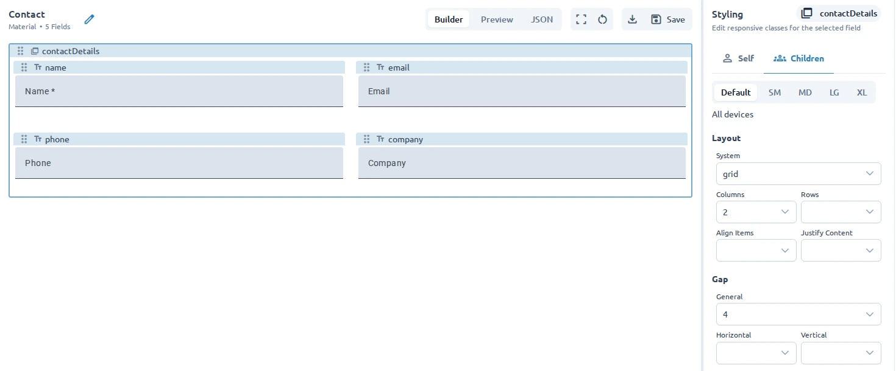

Use the **Styling** panel to adjust how a selected field or its group is arranged and displayed. Styling changes affect presentation; use **Field Edit** for labels, values, and validation.

## Select a field

1. Select a field in the canvas or **Fields** panel.
2. Open **Styling** in the sidebar.
3. Choose **Self** to style the selected field.
4. If the field contains other fields, choose **Children** to adjust its group layout.

The **Children** tab is available for container fields such as groups and repeaters.

## Style the selected field

For the selected field, the styling configuration provides controls for:

- Layout and column placement.
- Width and height.
- Margins and spacing around the field.
- Responsive variations for different screen sizes.
- Additional CSS class names when direct class control is needed.

The exact options depend on the configured styling system, which defaults to TailwindCSS. Use the controls to preview the change in the canvas, then switch to **Preview** to see the form without editing controls.

## Style a field group

For a container field, open **Children** to control the arrangement of its contents. Depending on the configured styling system, you can choose:

- A layout system such as flex, grid, or block.
- The direction of a flex layout.
- The number of grid columns or rows.
- Alignment and justification.
- Gaps and padding between or around children.

Use group styling to create a readable layout without changing the fields themselves.

:::caution
Responsive styling options and class names come from the editor's styling configuration rather than the UI library. The available options depend on the configured styling system. TailwindCSS is the default styling system.
:::

## Keep styling maintainable

Start with the default layout and make small changes. Prefer field and group layout controls over adding many custom class names, especially when the form should work across screen sizes.

Use [Structure fields](/guides/organizing-fields/) to build sections and repeating layouts, then
[Preview and test](/guides/previewing-and-testing/) the result.
