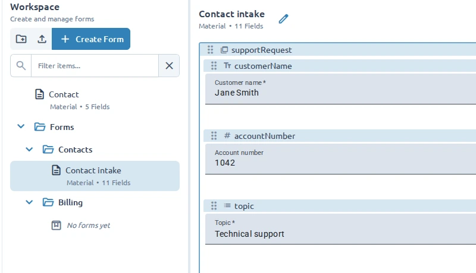

**Workspace** organizes complete form documents. Use the **Fields** panel instead when you need to
reorder or group fields inside the active form.

## Create a form

1. Open **Workspace** in the sidebar.
2. Select **Create Form**.
3. Enter a form name.
4. Choose **Blank Form** or a starter template.
5. Select **Create Form**.

A blank form requires a UI library. This choice determines its available fields and cannot be
changed later. A template selects its configured library automatically.

To create a form inside a folder, open the folder's **Options** menu and select **Add Form**.

## Organize forms with folders

Select **New folder** to create a top-level folder. To nest one, open a folder's **Options** menu and
select **Add Folder**. Select a folder row to expand or collapse it.

Organize forms by project, team, purpose, or another structure that makes them easy to find. An
expanded folder with no contents displays **No forms yet**.

## Open and find forms

Select a form in the Workspace tree to make it active. Its row can show the UI library and field
count.

Use the Workspace filter to search form and folder names. Matching folders and the path to matching
forms remain visible. Clear the filter when no results appear unexpectedly.

## Rename an item

1. Open the form or folder's **Options** menu.
2. Select **Edit Name**.
3. Enter the new name and save it.

Renaming a form changes its document name in Workspace. It does not change any field label or key.

## Delete an item

Open the form or folder's **Options** menu and select **Delete**.

Deleting a form removes only that document. Deleting a folder also removes every form and nested
folder it contains, so review its contents before confirming.

Forms and folders are stored in the current browser. See
[Save, import, and export](/guides/save-import-and-export/) before clearing browser data or moving to
another device.
