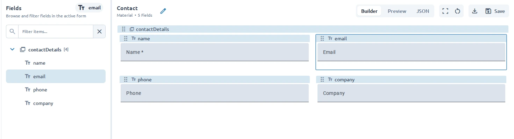

Use the form canvas and **Fields** panel to build a structure that is easy to understand and complete. You can add fields at the form root, add children to container fields, expand or collapse sections, and remove fields you no longer need.

## See the field structure

Open **Fields** in the sidebar. The panel shows the active form as a tree:

- Fields at the top level belong directly to the form.
- A field with a child count is a container with nested fields.
- Select a field to highlight it in the canvas and open its properties.
- Select an expanded container to collapse or reopen its children.

Use the filter when the form has many fields. The matching field and the path needed to reach it remain visible in the tree.

## Add fields to a section

1. Select a container field in the **Fields** panel or canvas.
2. Open its **Add Field** action.
3. Choose a field type or preset.

The new field is added inside that container. You can also use **Add** to add a field to the form, then arrange the form from the canvas where supported.

## Use groups

Use a **Group** when several related fields should be treated as one section, such as contact details or billing information. Add the related fields as children of the group, then use the group’s settings and [layout and styling controls](/guides/form-layout-and-styling/) to present the section clearly.

## Use repeaters

Use a **Repeater** when the active library provides one and a user may need to provide the same set of information more than once, such as multiple addresses or work experiences. A repeater contains a child field configuration that can be repeated when the form is used. See [UI Libraries](/ui-libraries/) for container availability and exact properties.

Container availability and behavior depend on the active UI library.

## Remove a field

1. Select the field in the **Fields** panel or canvas.
2. Open **Options**.
3. Select **Remove**.

Removing a container also removes the fields contained within it. Review the structure before removing a section.

:::note
The **Options** menu also includes **Save as Preset** for fields that are not the form root. Saving a field as a preset creates a reusable starting point; it does not change the current field.
:::

Use [Preview and test](/guides/previewing-and-testing/) to check the completed structure with realistic
values.
