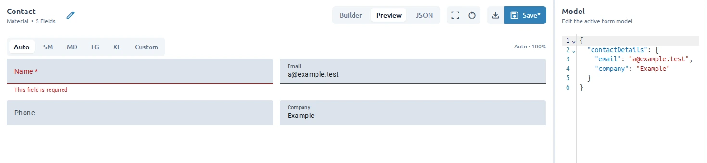

Use **Preview** to check the form without the Builder editing focus. Use **Model** to provide test values and verify how the form behaves with populated and empty data.

## Switch to Preview

1. Open a form in **Workspace**.
2. Select **Preview** in the display-mode control above the canvas.
3. Complete fields and trigger validation as a user would.

Preview renders the active form using the current model values. Return to **Builder** when you need to select fields or change their configuration.

For a larger view, select **Open preview**. Close the preview dialog to return to the editor.

## Test with Model values

**Model** is available in both **Builder** and **Preview**. Use it to edit test values, then switch between those modes to check how the form behaves with populated or empty data.

1. Open **Model** in the sidebar.
2. Edit the JSON values for the active form.
3. Check the populated form.

Model values help you test realistic states without changing the field definitions. For example, enter a value for a text field, select an option, or provide a date to check how the form renders.

:::caution
Model values are test data for the active form. They are separate from field settings such as labels, keys, and validation rules.
:::

## Check validation

In **Preview**, leave required fields empty or enter values that violate their configured rules. Confirm that the form shows the expected validation behavior and messages. Return to **Builder**, select the field, and use **Field Edit** to adjust its validation settings or messages.

## Clear test values

Select **Clear Model** in the toolbar to remove the current test values. This is useful when you want to repeat a test from an empty state.

## Builder, Preview, and JSON

- **Builder** is the visual editing mode.
- **Preview** is the user-facing form view.
- **JSON** is a read-only view of the form field configuration.

Use Builder for ordinary authoring and Preview for behavior checks. Use JSON when you need to inspect the generated field configuration; make changes in Builder.

Use [Add and configure fields](/guides/add-and-configure-fields/) when validation needs adjustment, or
[Inspect form JSON](/guides/working-with-json/) to review the configuration directly.
