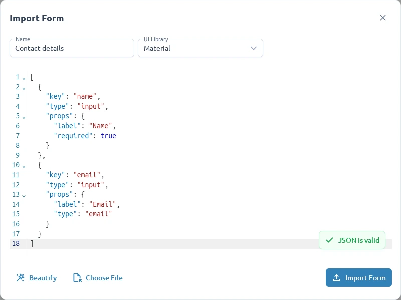

The Form Editor stores forms and Workspace folders in the current browser. This storage is
not shared across browsers or devices and is not a cloud backup.

## Save local changes

Select **Save Form** in the toolbar after editing. Workspace actions such as creating, renaming, or
deleting forms and folders persist their hierarchy changes as you make them.

Local forms can be lost when browser site data is cleared. Export important forms before clearing
site data, changing browsers, or moving to another device.

## Export a portable copy

1. Open the form and select **Export Form** in the toolbar.
2. Confirm or update its name.
3. Review the generated JSON.
4. Select **Export Form** in the dialog.

The downloaded JSON contains the supported Formly field configuration, including field order,
properties, nested `fieldGroup` structures, and `fieldArray` containers. Editor-only metadata and
the rest of the Workspace are not included.

Use the exported file as a backup, share it with another Studio user, or
[integrate it into Angular](/developers/use-an-exported-form/).

## Import a form

1. Open **Workspace** in the sidebar and select **Import Form**.
2. Enter a name for the new form.
3. Select the UI library that supports the configuration's field types.
4. Paste a JSON array or choose a `.json` or `.txt` file.
5. Resolve any validation messages and select **Import Form**.



Import creates a new form and makes it active. It does not replace the previously active form.

The JSON must contain a top-level `FormlyFieldConfig[]`. JSON Schema and Angular templates are not
supported inputs.

```json
[
  {
    "key": "email",
    "type": "input",
    "props": {
      "label": "Email address"
    }
  }
]
```

Nested groups and field arrays are supported. Untyped nodes containing `fieldGroup` are treated as
groups. Custom Formly types must be registered both in Studio and in the consuming Angular
application.

## Resolve import errors

| Message                               | Resolution                                                              |
| ------------------------------------- | ----------------------------------------------------------------------- |
| **Name is required**                  | Enter a name for the imported form.                                     |
| **JSON format is not valid**          | Correct malformed quotes, commas, or brackets.                          |
| **JSON root must be an array**        | Wrap the field objects in `[` and `]`.                                  |
| **Schema errors**                     | Use the reported path to find the unsupported property.                 |
| **Unknown or unavailable field type** | Select the correct UI library or replace the type with a supported one. |

Unknown types are rejected rather than silently converted. Because a form's UI library cannot be
changed after creation, select the matching library during import.

Use [Inspect form JSON](/guides/working-with-json/) to review generated configuration without editing
it, or [Preview and test](/guides/previewing-and-testing/) before exporting.
