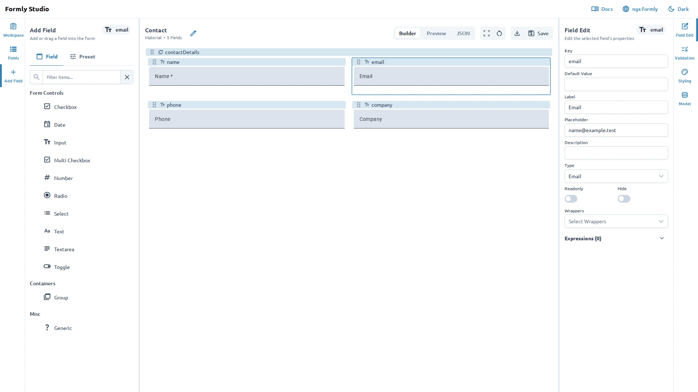

import { Image } from 'astro:assets';
import mobileEditor from '../../../assets/screenshots/editor-tour-mobile.webp';

The Form Editor places its panels around the central workspace. Their location changes with the
available screen width, but the panel names and workflows remain the same.

The active form and Workspace organization are saved in the current browser. See
[Save, import, and export](/guides/save-import-and-export/) for backup and portability.

## Find a panel

On wider screens, the editor uses two sidebars:

- The left sidebar contains **Workspace**, **Fields**, and **Add Field**.
- The right sidebar contains **Field Edit**, **Validation**, **Styling**, and **Model**.

On smaller screens, one toolbar on the left contains all seven panels. Select a panel there to open
it beside the canvas or in a drawer, depending on the available space. Instructions in these docs
refer to panels by name rather than by sidebar position.

<Image
  src={mobileEditor}
  alt="Field Edit drawer at phone width, with all seven panels accessible in the left toolbar."
  style="width: 100%; max-width: 390px; height: auto;"
/>

Use the panels for these tasks:

- **Workspace**: create, select, filter, and import forms.
- **Fields**: view the form structure and select a field.
- **Add Field**: add a field or a reusable preset.
- **Field Edit**: change properties for the selected field.
- **Validation**: configure validation rules and messages.
- **Styling**: adjust available styling options.
- **Model**: edit values used to test the form.

When there are no forms yet, the **Workspace** panel provides a **Create Form** action.

## Center workspace

The center workspace displays the active form. Use the display modes in the toolbar to switch between:

- **Builder**: edit the form visually.
- **Preview**: check the form as a user would see it.
- **JSON**: inspect the form configuration in a read-only view.

The toolbar also shows the form name, the active UI library, and the current field count.

Select a field in the canvas or **Fields** panel before opening **Field Edit**. Select **Model** when you want to test the form with example values.

## Toolbar actions

The toolbar includes these actions:

- **Edit form name**: rename the active form.
- **Open preview**: open a larger preview window.
- **Clear Model**: remove the current test values.
- **Export Form**: review and export the form JSON.
- **Save Form**: save the current form in the browser-local form store. Workspace actions persist their own folder and form hierarchy changes.

Use [Manage your workspace](/guides/manage-your-workspace/) for forms and folders. See
[Troubleshooting](/guides/empty-states-and-recovery/) when a panel has nothing to show.
